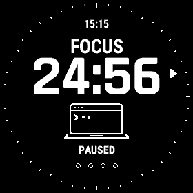
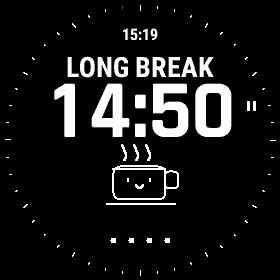

# Flow

A simple Pomodoro timer for Garmin tactix 7 / fenix 7X devices.

 

Focus has a tiny typing terminal; breaks have a smiling cup with moving steam. START or a screen tap starts and pauses the timer. BACK or hold MENU opens session controls. The default cycle is 25 minutes of focus, 5-minute short breaks, and a 15-minute break after four completed focus sessions. Durations and vibration can be changed on the watch.

Flow vibrates when a session ends and prepares the next one for a START press. Leaving the app pauses and saves the session; it does not alert while another app or watch face is open. Skipped focus sessions do not count toward the long break.

## Build and test

Install the [Connect IQ SDK](https://developer.garmin.com/connect-iq/sdk/) with the `fenix7x` device package and Java 17. Place your private developer key at `bin/developer_key.der`, then run:

```sh
make build      # bin/Flow.prg for direct installation
make test       # six timer tests in the simulator
```

The Makefile uses Homebrew paths on macOS; adjust `JAVA_HOME` and `PATH` for another setup. Keep the signing key private and backed up for future updates. The key and build files are ignored by Git.

## Install without the store

Connect the watch by USB. On macOS, open its storage with an MTP file manager such as [OpenMTP](https://openmtp.ganeshrvel.com/); the tactix 7 may not appear in Finder. Copy **`bin/Flow.prg`** into **`GARMIN/Apps`** on the watch, replacing an older copy if present. Disconnect the watch, then open **Flow** from its apps list.

## Privacy

Flow stores session progress, durations, and vibration preference on the watch. It does not use GPS, send data to a server, or require an account.
